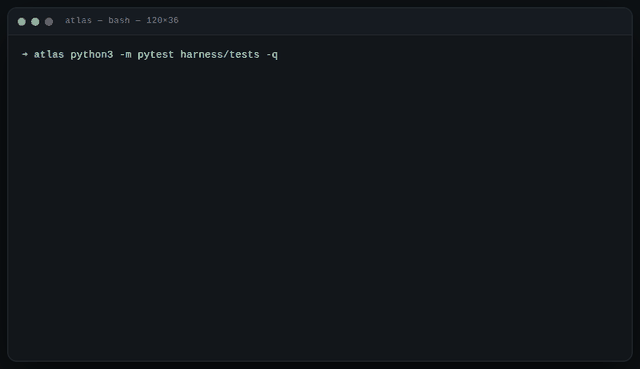
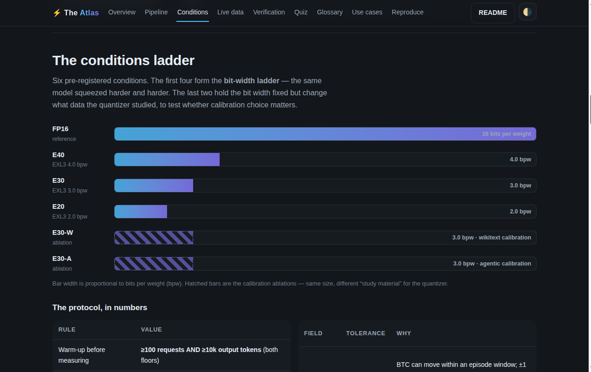
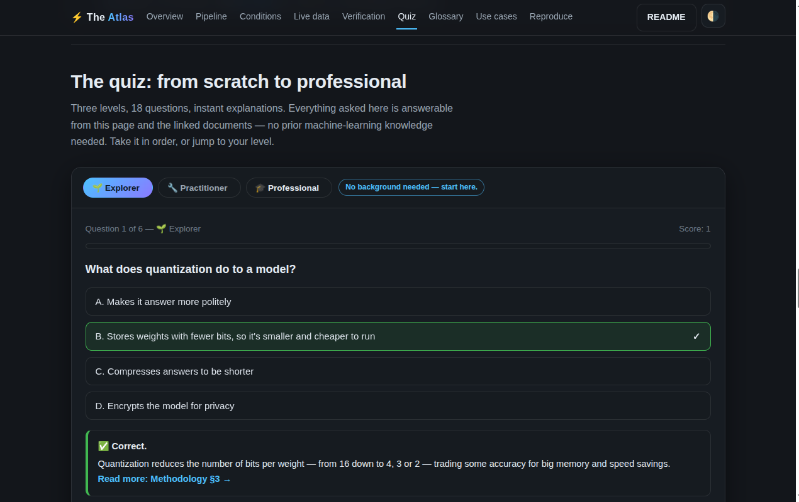
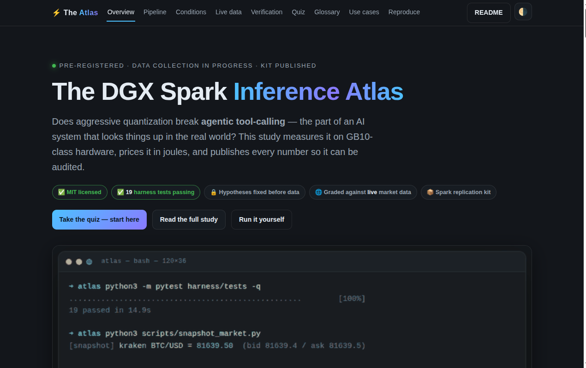

# The DGX Spark Inference Atlas

[](LICENSE)
[](#1-what-is-verified-in-this-repository-status)
[](docs/METHODOLOGY.md)
[](docs/VERIFICATION.md)
[](docker/docker-compose.yml)
[](docs/SPARK_KIT.md)

**Quantized serving of agentic workloads on GB10-class hardware: degradation
patterns, energy, and reproducibility — with every number in this README
generated from committed run artifacts.**

> **In plain words.** Squeeze a language model to a fraction of its size — does it still *do the job*? This repository is a public, auditable experiment that compresses one model from 16 bits per weight down to 4, 3 and 2, then makes it perform real tasks: look up live Bitcoin and euro prices, convert currencies, and answer in exact formats. Every rule was published before the first measurement, every number below is generated from committed evidence files, and the prices the model is graded against are fetched — with a cryptographic fingerprint — at the moment of each test. Where results don't exist yet, the tables say "no data yet". An atlas that invents numbers is a novel, not an atlas.

> 🔎 **Two-minute version:** open [`preview.html`](preview.html) — this README's facts as an interactive page with a dashboard, the bit-width ladder, a glossary and an 18-question quiz. Prefer reading? Start with the [🌱 beginner guide](#-beginner-guide--read-this-and-you-are-a-professional).

This repository is a pre-registered measurement study, not a leaderboard. It
asks whether aggressive quantization (EXL3 trellis 2–4 bpw) preserves
*agentic* tool-calling capability, not just perplexity; where failures
concentrate; what it costs in joules; and how the existing DGX Spark serving
claims (TensorFold vs vLLM, EXL3 vs NVFP4) survive replication under a
fixed protocol.

- **Pre-registration:** all hypotheses, conditions, tolerances and analysis
  choices were fixed *before* data collection — [`docs/METHODOLOGY.md`](docs/METHODOLOGY.md).
- **Live-data grounding:** every evaluated agent episode calls *real*
  Kraken/Frankfurter endpoints at episode time; the served values are the
  episode's truth — [`docs/VERIFICATION.md`](docs/VERIFICATION.md).
- **Mechanical honesty:** no README number is hand-typed; the marked blocks
  below are written only by [`scripts/sync_readme.py`](scripts/sync_readme.py)
  from `results/` artifacts.
- **Executable anywhere, replicable on Spark:** `docker compose` smoke path
  runs on any machine; [`docs/SPARK_KIT.md`](docs/SPARK_KIT.md) is the full
  GB10 replication protocol for the community speed dispute.
- **Beginner-friendly:** the [🌱 beginner guide](#-beginner-guide--read-this-and-you-are-a-professional)
  below takes you from "what is a token" to pre-registered statistics, and
  [`preview.html`](preview.html) quizzes you as you go — Explorer, Practitioner,
  Professional.
- **Interactive by default:** the animated demo below, a zero-dependency
  interactive preview page, and a one-minute GitHub Pages deploy
  ([instructions below](#interactive-preview--github-pages)).



*The demo above is the whole discipline in one loop: tests pass, reality is
captured with a fingerprint, and the README's tables regenerate themselves
from the committed artifacts. If the artifacts don't change, neither does the
README.*

## Quick start

```bash
python3 -m pytest harness/tests -q                            # 19 tests — no GPU needed
docker compose -f docker/docker-compose.yml run --rm smoke    # container reproducibility floor
python3 scripts/sync_readme.py                                # regenerate every number in this README
```

These three commands run on any machine, with or without a GPU. The full
measurement pipeline (bit-width ladder, live-data episodes, energy protocol,
Spark replication) is in [§7 Reproduce](#7-reproduce).

## Contents

- [🌱 Beginner guide — read this and you are a professional](#-beginner-guide--read-this-and-you-are-a-professional)
- [Quick start](#quick-start)
- [Interactive preview & GitHub Pages](#interactive-preview--github-pages)
- [1. What is verified in this repository (status)](#1-what-is-verified-in-this-repository-status)
- [2. The strategy under test](#2-the-strategy-under-test)
- [3. Method in one paragraph](#3-method-in-one-paragraph)
- [4. Results — agentic arm (live-data tool calling)](#4-results--agentic-arm-live-data-tool-calling)
- [5. Results — timing & energy arm](#5-results--timing--energy-arm)
- [6. Provenance ledger](#6-provenance-ledger)
- [7. Reproduce](#7-reproduce)
- [8. Deviations log](#8-deviations-log)
- [9. Repository map](#9-repository-map)
- [10. Limitations (short form)](#10-limitations-short-form)
- [Glossary — every term in one sentence](#glossary--every-term-in-one-sentence)
- [FAQ — frequently asked questions](#faq--frequently-asked-questions)
- [Who this is for](#who-this-is-for)
- [Citation](#citation)

---

## 1. What is verified *in this repository* (status)

| Milestone | Evidence (committed artifact) | Status |
|---|---|---|
| Harness statistics validated (known-value tests) | `harness/tests/test_stats.py` — 16 tests | ✅ passing |
| Live-data graders validated end-to-end | `harness/tests/test_toolcall_eval.py` (1 test; skips cleanly offline), mock episode run in `results/raw/toolcall-mock-smoke-*` (excluded from tables by rule) | ✅ passing |
| Live market fetch + tolerance policy exercised | `results/raw/market-20261018T0855*.json` | ✅ pinned |
| Environment capture (host + container) | `results/raw/env-*.json` (two: host run, docker smoke) | ✅ |
| Docker Compose reproducibility floor | `docker compose run --rm smoke` → offline test suite in-container (19 tests locally; live test skips offline) | ✅ |
| Runner protocol (warm-up, isolation, energy) | `harness/bench/runner.py` + `harness/tests/test_runner.py` (2 mock-server tests) | ✅ implemented |
| EXL3 bpw ladder on local GPU (RTX 3090) | see generated tables below | ⏳ in progress |
| Quality arm (KLD vs FP16) | `results/derived/quality-*.json` when present | ⏳ pending |
| Spark arm (GB10) | [`docs/SPARK_KIT.md`](docs/SPARK_KIT.md) | 📦 kit published |

## 2. The strategy under test

The atlas verifies the serving strategy pinned in community discussions
through 2026: EXL3 quants of GLM-5.3-Flash / DeepSeek-v4.1-Flash / Qwen3.8
served with MTP or DFlash2 speculative decoding on one or two DGX Spars, and
the three-way dispute over TensorFold vs patched-vLLM vs SGLang throughput.
The *claims* are catalogued and quarantined as external in
[`docs/RELATED_WORK.md`](docs/RELATED_WORK.md) §5 — including the direct
contradiction (`TensorFold 1.6–3× vLLM` vs `patched vLLM faster than
TensorFold v0.6`) that the Spark Kit exists to adjudicate. **None of those
numbers appear in our tables; only numbers we measured do.**

## 3. Method in one paragraph

Conditions run one at a time (sequential isolation) with drained warm-up per
the IETF benchmarking-methodology draft — both floors (≥100 requests **and**
≥10k output tokens); streaming TTFT and decode rate are recorded per request;
NVML cumulative energy is read per condition (idle-subtracted net reported,
never clamped); agentic episodes execute live tools
and are graded deterministic-first into C_tool / C_task / C_outcome cells
(Tool-Veritas structure) with repair attempts flagged, never forgiven.
Paired comparisons vs FP16 use McNemar exact; equivalence requires TOST;
the bpw ladder gets permutation-tested changepoint analysis; the whole family
is Holm-Bonferroni corrected. Full details and limitations:
[`docs/STATISTICS.md`](docs/STATISTICS.md).

## 4. Results — agentic arm (live-data tool calling)

Graded on live Kraken BTC/USD + Frankfurter EUR/USD at episode time;
tolerances ±1.0 % (BTC) / ±0.1 % (EUR). A repaired-but-correct answer scores
C_task but not C_outcome.

<!-- BEGIN:gen:agentic -->
| condition | bpw | episodes | C_tool | C_task | C_outcome (95% CI) | repair-needed | vs FP16 (McNemar exact) |
|---|---|---|---|---|---|---|---|
| _no episodes recorded yet_ | | | | | | | |
<!-- END:gen:agentic -->

Changepoint note (pre-registered pattern-location analysis, α=0.01):

<!-- BEGIN:gen:changepoints -->
_Changepoint analysis requires ≥4 ladder points (fp16 + 3 quantized); not yet available._
<!-- END:gen:changepoints -->

## 5. Results — timing & energy arm

Protocol: fixed-shape prompts (published in `runner.py`), 256-token
generations, temperature 0, 5 repetitions, f16/fp16 reference included.
`CV flag ⚠` marks conditions violating the pre-registered isolation gate
(CV ≤ 0.10), whose comparisons are treated as suspect. `J/token` is the
idle-subtracted net value when the idle probe succeeded on the box,
otherwise the gross counter delta; net values are never clamped at zero.
Rows whose endpoint did not stream are marked in the condition notes and
excluded from decode tok/s.

<!-- BEGIN:gen:timing -->
| condition | warm-up | p50 ms | p90 ms | decode tok/s (p50) | CV flag | J/token | errors |
|---|---|---|---|---|---|---|---|
| _no timing runs recorded yet_ | | | | | | | |
<!-- END:gen:timing -->

## 6. Provenance ledger

Every table above is mechanically derived from these artifacts; hashes and
the exact generation manifest live in `results/derived/readme-sync.json`.

<!-- BEGIN:gen:provenance -->
| artifact class | count | latest |
|---|---|---|
| market snapshots | 2 | market-20261018T085533Z.json |
| environment captures | 3 | env-20261018T094229Z.json |
| runner runs (timing) | 0 | — |
| tool-call runs | 0 | — |
<!-- END:gen:provenance -->

## 7. Reproduce

```bash
# 1) harness self-tests (19 tests: 16 statistics, 1 live-data grader that
#    skips offline, 2 mock-server runner tests)
python3 -m pytest harness/tests -q

# 2) container reproducibility floor (works without a GPU)
docker compose -f docker/docker-compose.yml run --rm smoke

# 3) capture environment + live snapshot artifacts
python3 scripts/collect_env.py && python3 scripts/snapshot_market.py

# 4) serve any OpenAI-compatible endpoint, then:
python3 -m harness.bench.runner --endpoint http://127.0.0.1:8080/v1 \
    --model MODEL --tag e30 --requests 8 --reps 5 --concurrency 1,4
python3 scripts/run_toolcall.py --endpoint http://127.0.0.1:8080/v1 \
    --model MODEL --tag e30 --episodes 30

# 5) regenerate every number in this README from the artifacts
python3 scripts/sync_readme.py
```

GPU toolchain (torch + exllamav3): `bash scripts/setup_gpu.sh`.
DGX Spark (GB10) full protocol: [`docs/SPARK_KIT.md`](docs/SPARK_KIT.md).

## 8. Deviations log

Per METHODOLOGY §7, deviations are recorded, not papered over. Current log:

- **2026-10-18 — local arm runs on RTX 3090 (sm_86), not GB10 (sm_121).**
  Transfer claims are stated as method-level only; Spark numbers are
  external and marked as such. The Spark Kit exists precisely for this gap.
- **2026-10-18 — `torch` wheel download initially failed** (interrupted
  cudnn fetch); setup retried with resumable downloads and recorded.
- **2026-10-18 — mock-endpoint run exists in `results/raw/toolcall-mock-smoke-*`**
  and is excluded from all tables by rule (`model == "mock"`).
- **2026-10-18 — pre-data harness corrections (no measured results existed
  yet, so nothing below is retro-edited evidence).** An audit fixed, before
  data collection: warm-up exited on the first floor satisfied (now requires
  **both** ≥100 requests and ≥10k output tokens); non-streaming responses had
  their total latency recorded as TTFT and polluted decode tok/s (now marked
  `ttft_is_total` and excluded with a note); the energy meter never closed
  its NVML window (net J/token could exceed gross; now end-read on exit, net
  never clamped); CV used population stdev (now sample CV, NaN below n=2);
  a partial final request batch could deadlock the wave barrier (now batched);
  the grader's truth check raised `KeyError` on missing keys (now fail-closed)
  and C_outcome conflated tool-call and task success (now C_tool ∧ C_task ∧
  no-repair); README macro generation could emit underscore names and read
  wrong timing keys (now sanitized + `p50_ms`/`p90_ms` with zero-default
  macros). Statistical power notes were corrected to the Connor (1987)
  normal-approximation MDE (≈0.51 at π_d=1, ≈0.30 at π_d≈1/3 for N=30).

## 9. Repository map

```
docs/      METHODOLOGY (pre-registration) · STATISTICS · VERIFICATION · RELATED_WORK · SPARK_KIT
harness/   bench/ (live_data, stats, metrics, toolcall_eval, runner) · tests/
scripts/   collect_env · snapshot_market · run_toolcall · sync_readme · setup_gpu
docker/    Dockerfile · docker-compose.yml (smoke + GPU serving profiles)
results/   raw/ (immutable evidence) · derived/ (tables, macros, manifests)
papers/    LaTeX paper skeleton consuming generated macros (PACT-2026-AE-style artifact appendix)
```

## 10. Limitations (short form)

Small local models (see METHODOLOGY §3.1) bound absolute quality claims; the
ladder shape and method transfer, the absolute numbers do not. N=30 episodes
per condition detects large collapses only (power analysis in METHODOLOGY §6);
`CV flag ⚠` conditions are excluded from ladder fitting. NVML energy is
whole-device and protocol-relative (STATISTICS §7). External claims remain
external until replicated with the Spark Kit.

---

## 🌱 Beginner guide — read this and you are a professional

No prior machine-learning knowledge is required for this section. If you can
follow a weather report, you can follow this. It is the written companion to
the quiz in [`preview.html`](preview.html): read it once, take the quiz, and
you will be able to explain every number in this repository — and every
caveat — without bluffing.

**Let's work this out in a step-by-step way to be sure we have the right answer.**

### Step 0 · The whole idea in six sentences

1. A language model is a very large pile of numbers (its *weights*) that turns
   text into text.
2. *Quantization* stores those numbers with fewer bits — 16 → 4 → 3 → 2 bits
   per weight ("bpw") — so the model needs less memory and answers faster.
3. Smaller and faster is the whole point — but **does quality survive?**
   Especially when the model must not just chat, but *act*: fetch a live price,
   convert a currency, and answer in an exact format.
4. This repository answers that question the strict way: one model family, a
   six-condition ladder (an FP16 reference plus 4/3/2-bit conditions and two
   calibration ablations), measured under a protocol written down *before* any
   data was collected.
5. "The strict way" means thresholds fixed in advance, live market prices
   fetched *during* each test so answers cannot be memorized, statistics that
   account for testing many hypotheses at once, and every table regenerated
   mechanically from committed evidence files.
6. Where results do not exist yet, the tables say so — literally "no data yet"
   ([§4](#4-results--agentic-arm-live-data-tool-calling),
   [§5](#5-results--timing--energy-arm)). An atlas that invents numbers is a
   novel, not an atlas.

### Step 1 · The vocabulary ladder

Read these in order; each step builds on the last.

1. **Token.** A small chunk of text — roughly three-quarters of a word — that
   the model reads and writes. Everything is measured per token: speed in
   *tokens per second*, energy in *joules per token*.
2. **Weights and FP16.** The model's learned numbers are called weights.
   "FP16" means each weight is stored in 16 bits — full size, best quality.
   The FP16 model is this study's reference: every comparison is made against
   it, on the same questions.
3. **Quantization and bpw.** Storing weights with fewer bits. This study's
   ladder: a 4.0-bit condition (E40), then 3.0 (E30), then 2.0 (E20) — "bpw"
   is bits per weight. The quantized builds are EXL3 (ExLlamaV3) trellis
   models.
4. **Calibration corpus.** The text a quantizer "studies" while deciding how
   to compress. The two ablations answer a practical question: at the same
   3.0 bpw, does studying *agentic transcripts* (E30-A) beat studying *generic
   text* (wikitext, E30-W)?
5. **Why not just measure perplexity?** Perplexity — how "surprised" a model
   is by sample text — is the classic quality metric, but it does not tell you
   whether the model can *finish a task*. This study grades task success, not
   vibes: tool calls, arithmetic, formatting, and honesty under a tolerance.
6. **Agentic tool-calling and episodes.** The model must decide to call tools
   (fetch a price, convert a currency), form correct arguments, and format the
   final answer. One complete attempt is an *episode* — the unit of evidence.
7. **The three grades: C_tool, C_task, C_outcome.** Nested, honest checks.
   C_tool: were the tool calls valid? C_task: is the final answer correct
   within tolerance? C_outcome: both, **with no repair** —
   C_outcome = C_tool ∧ C_task ∧ no-repair. A repaired-but-correct answer
   earns C_task but not C_outcome; repairs are flagged, never forgiven.
8. **Live-data grounding and tolerance.** Episodes are graded against values
   fetched from Kraken and the ECB at episode time — ±1.0 % for Bitcoin
   fields, ±0.1 % for EUR/USD. A memorized or hallucinated number cannot pass
   a moving target. Every fetch records its URL, timestamp, response body and
   SHA-256 fingerprint ([`docs/VERIFICATION.md`](docs/VERIFICATION.md)).
9. **Warm-up and isolation.** A cold machine distorts measurements, so each
   condition runs practice traffic first — both floors: ≥100 requests **and**
   ≥10,000 output tokens. The isolation gate is a coefficient of variation
   (CV) ≤ 0.10; conditions that wobble more are flagged `⚠` and treated as
   suspect.
10. **Timing and energy.** TTFT = time to first token (how fast the model
    starts answering). Decode rate = tokens per second once it starts. Energy
    = joules per token, read from NVIDIA's telemetry (NVML), reported net of
    idle draw, and *never clamped* at zero
    ([`docs/STATISTICS.md`](docs/STATISTICS.md) §7).
11. **Pre-registration.** Hypotheses (H1–H5), sample sizes, tolerances and
    analysis methods were fixed in [`docs/METHODOLOGY.md`](docs/METHODOLOGY.md)
    *before* data collection. This is what makes the study falsifiable — and
    why the deviations log in [§8](#8-deviations-log) exists instead of quiet
    edits.
12. **The statistics trio, in plain words.** *McNemar's exact test* compares
    two conditions on the same episodes, looking only at where they disagree.
    *TOST equivalence* is the only way this study will ever say "no
    difference": proving both directions stay inside a pre-declared margin
    (±5 percentage points here). *Bootstrap confidence intervals* give the
    effect's range, reproducible from a fixed seed. *Holm–Bonferroni* keeps
    the overall error rate honest across many tests. And the implementations
    are pinned to known values by 16 tests — the judges are judged.
13. **Power and the minimum detectable effect (MDE).** With 30 episodes per
    condition, the study can reliably see only *large* collapses (≈0.51 at
    worst, ≈0.30 typical). That is stated openly in
    [§10](#10-limitations-short-form), not hidden — an honest study tells you
    what it *cannot* see.
14. **Changepoints.** A point on the bit-width ladder where results bend.
    Reported as pattern location, never as proof of cause, and only when at
    least four ladder points exist.
15. **Provenance and idempotent regeneration.** Every number carries its
    origin, and [`scripts/sync_readme.py`](scripts/sync_readme.py) regenerates
    the tables mechanically: run it twice and the output is byte-identical.
    Hashes live in `results/derived/readme-sync.json`. A changed hash without
    new raw artifacts is treated as a tampering signal. Mock runs are excluded
    from all tables by rule.

### Step 2 · How to read the results tables

**Agentic table** ([§4](#4-results--agentic-arm-live-data-tool-calling)) — one
row per condition:

| Column | What it means |
|---|---|
| condition, bpw | the bit-width ladder rung (E40 = 4.0 bits, E30 = 3.0, E20 = 2.0, …-W/-A = calibration ablation) |
| episodes | how many graded live-data attempts that condition has — the sample everything else is computed from |
| C_tool / C_task | share of episodes whose tool calls were valid / whose final answer was within tolerance |
| C_outcome (95 % CI) | the strict joint grade with its bootstrap confidence interval |
| repair-needed | how often the model needed a second attempt (shown, not punished silently) |
| vs FP16 (McNemar exact) | the paired test against the reference on the same episodes |

**Timing table** ([§5](#5-results--timing--energy-arm)) — one row per
condition: warm-up volume, p50/p90 latency, decode tokens per second, the CV
isolation flag, net joules per token, and error counts. `⚠` means the
condition violated the isolation gate and its comparisons are treated as
suspect.

Every column in both tables is machine-generated; none is hand-typed. When a
run lands in `results/raw/`, the table row appears; when it doesn't, the table
says "no data yet". That single rule is most of what "pre-registered,
auditable study" means in practice.

### Step 3 · See the ladder



Read it left to right: the reference first, then down the bit-width ladder,
then the two ablations. The labels on each rung (quality, speed, memory) are
the study's working quantitative hypotheses — they become results only when
artifacts land, and every change of course is logged in
[§8](#8-deviations-log).

### Step 4 · Prove it yourself

```bash
python3 -m pytest harness/tests -q    # the 19 tests validate the judges — no GPU needed
python3 scripts/sync_readme.py        # regenerate every number in this README from results/
python3 scripts/sync_readme.py        # run it again: byte-identical output, by design
```

Then open `results/derived/readme-sync.json` — the provenance manifest —
and compare its recorded hashes with the files in `results/raw/`. If the
hashes match the artifacts and the tables match each other on two runs, you
have personally verified this repository's central honesty claim. Nothing
here asks to be taken on faith.

### Step 5 · The path to professional

| Level | Do this | You can then explain |
|---|---|---|
| 🌱 Explorer | Read [§1](#1-what-is-verified-in-this-repository-status)–[§2](#2-the-strategy-under-test), then the Explorer tier of the quiz | what quantization, bpw and agentic tool-calling mean |
| 🔧 Practitioner | Read [§3](#3-method-in-one-paragraph) and [`docs/VERIFICATION.md`](docs/VERIFICATION.md), then the Practitioner tier | live-data grounding, tolerances, C_tool / C_task / C_outcome |
| 🎓 Professional | Read [`docs/STATISTICS.md`](docs/STATISTICS.md) and [§8](#8-deviations-log), then the Professional tier | McNemar, TOST, CV gates, MDE, and why deviations are logged |
| 🔬 Field expert | Run the [quick start](#quick-start), then read [`docs/SPARK_KIT.md`](docs/SPARK_KIT.md) | how to reproduce the pipeline and defend its limitations ([§10](#10-limitations-short-form)) |



Take the quiz in [`preview.html`](preview.html) until all three levels are
cleared. **You will know more than most interview candidates.** (Most cannot
explain pre-registration, TOST equivalence, or why the graded prices are
fetched live — after this guide, you can.)

## Glossary — every term in one sentence

| Term | In one sentence |
|---|---|
| **Quantization** | Storing a model's weights with fewer bits (e.g. 4 instead of 16) so it uses less memory and runs faster — at some cost to accuracy. |
| **bpw (bits per weight)** | How many bits each model weight uses. Lower = smaller and cheaper, usually at a quality cost. This study's ladder: 16 → 4 → 3 → 2. |
| **FP16 (the reference)** | The unquantized 16-bit model. Every comparison is made against it, on the very same questions. |
| **EXL3 / ExLlamaV3** | A modern quantization method and serving stack (ExLlamaV3) used for the 4/3/2-bit conditions; "EXL3" names its trellis-based format. |
| **Calibration corpus** | The text a quantizer studies while choosing how to compress. This study tests whether studying agentic transcripts beats studying generic text (wikitext). |
| **Agentic tool-calling** | The model must decide to use tools (fetch a price, convert a currency), form correct arguments, and format the result — not just chat. |
| **Episode** | One complete task attempt: question → tool calls → live data → final answer → grade. The unit of evidence. |
| **C_tool / C_task / C_outcome** | Three nested honest checks: tool calls valid; final answer correct within tolerance; and both done with no repair needed. C_outcome = C_tool AND C_task AND no repair. |
| **Live-data grounding** | Grading against values fetched from Kraken and the ECB at episode time, so memorized or hallucinated answers can never pass. |
| **Tolerance** | The allowed error on a quoted value: ±1.0 % for BTC fields, ±0.1 % for EUR/USD — set before data collection with stated reasoning. |
| **Provenance** | The recorded origin of every number: URL, timestamp, response body and its SHA-256 fingerprint. Nothing is anonymous. |
| **Pre-registration** | Fixing hypotheses, sample sizes and analysis methods before seeing data, so you can't quietly move the goalposts afterwards. |
| **Warm-up** | Practice runs before measuring (here: at least 100 requests and 10,000 output tokens) so a cold machine never distorts results. |
| **TTFT** | Time To First Token: how long until the model starts answering. Measured only for streaming responses; flagged otherwise. |
| **CV (coefficient of variation)** | How wobbly a measurement is, relative to its size. Above 0.10 the condition is flagged and treated as suspect. |
| **McNemar's exact test** | A paired statistical test that compares two conditions on the same episodes by looking only at where they disagree. |
| **TOST (equivalence testing)** | The only way this study will ever claim "no difference": proving both directions stay inside a pre-declared margin (±5 percentage points here). |
| **Holm–Bonferroni** | A correction that keeps the overall error rate honest when many hypotheses are tested at once. |
| **Minimum detectable effect (MDE)** | The smallest difference a study of this size can reliably see: ≈0.51 at worst, ≈0.30 typically, for 30 episodes — it detects large collapses, and says so. |
| **Changepoint** | A point on the bit-width ladder where results bend. Reported as pattern location, never as proof of a cause. |
| **NVML / joules** | NVIDIA's telemetry interface, used to measure joules per generated token — reported both gross and idle-subtracted, never clamped. |
| **Mock run** | A fake model used only to smoke-test the pipeline. Excluded from all tables by rule, forever. |
| **Idempotent regeneration** | Running the table generator again produces byte-identical files. If hashes change without new raw artifacts, something is wrong — and the project treats that as a tampering signal. |

## FAQ — frequently asked questions

**Is this a leaderboard?**
No. It ranks nothing and sells nothing. It is a single-model, pre-registered
measurement study. External speed claims (TensorFold vs patched-vLLM vs
SGLang, EXL3 vs NVFP4) are catalogued and quarantined in
[`docs/RELATED_WORK.md`](docs/RELATED_WORK.md) §5 — none of their numbers
appear in our tables ([§2](#2-the-strategy-under-test)).

**Why are the results tables still empty?**
Because the honest number of completed measurement runs is zero so far, and
fabricating a row would violate the study's own rules. The tables fill in as
artifacts land ([§1](#1-what-is-verified-in-this-repository-status)); "no data
yet" beats a confident guess — this project exists to remove confident
guesses.

**What hardware is this for?**
The protocol targets DGX Spark (GB10-class) machines. The local arm currently
runs on an RTX 3090, which is a logged deviation
([§8](#8-deviations-log)) — so transfer claims are method-level only. The
full GB10 replication protocol is in
[`docs/SPARK_KIT.md`](docs/SPARK_KIT.md).

**Why is a language model graded against the Bitcoin price?**
Because a moving target cannot be memorized. Each episode must fetch the live
value and use it within tolerance (±1.0 % BTC, ±0.1 % EUR/USD); stale or
invented numbers fail. Each fetch is fingerprinted (URL, time, body, SHA-256)
and verifiable after the fact.

**What is pre-registration, in one line?**
Writing down your hypotheses, sample sizes and pass/fail rules *before*
looking at data, so you cannot quietly move the goalposts afterwards. Ours is
[`docs/METHODOLOGY.md`](docs/METHODOLOGY.md).

**What do E40 / E30 / E20 / E30-W / E30-A mean?**
Each is a condition: E40 = 4.0 bits per weight, E30 = 3.0, E20 = 2.0. The
-W/-A suffixes are the same 3.0 bpw with different calibration data
(W: generic wikitext; A: agentic transcripts). The reference condition is the
unquantized FP16 model.

**Why only 30 episodes per condition?**
Because the pre-registered power analysis says 30 detects *large* collapses
only (MDE ≈0.51 worst case, ≈0.30 typical). The study states what it can and
cannot see ([§10](#10-limitations-short-form)) instead of hiding it — most
benchmarks don't.

**How do you keep yourselves honest?**
Six mechanisms: pre-registration ([§3](#3-method-in-one-paragraph)); 19 tests
that pin the statistics implementations to known values
([§1](#1-what-is-verified-in-this-repository-status)); graders grounded in
live market data ([`docs/VERIFICATION.md`](docs/VERIFICATION.md)); mechanical,
hash-recorded table generation ([§6](#6-provenance-ledger)); a deviations log
instead of silent edits ([§8](#8-deviations-log)); and mock runs excluded by
rule, forever.

**Can I reuse the methodology or the code?**
Yes — MIT license ([`LICENSE`](LICENSE)). The pre-registered protocol,
graders, energy instrumentation and statistics are designed to be forked for
other models and hardware; cite the repository (see
[Citation](#citation)).

**Do I need a GPU to explore this repository?**
No. The test suite and the container smoke path run anywhere (see
[quick start](#quick-start)); the ladder and episodes need an NVIDIA GPU; the
Spark kit targets GB10-class machines.

## Who this is for

- **Curious newcomers** — the [🌱 beginner
  guide](#-beginner-guide--read-this-and-you-are-a-professional) and the quiz
  take you from zero to literate in the quantization debate.
- **ML engineers and quant practitioners** — a pre-registered answer to "how
  far down the bit-width ladder can I actually go before agentic tasks
  break?"
- **Compression and quantization researchers** — calibration ablations
  (agentic vs generic corpora), boundary-aware grading, and a changepoint
  analysis that is honest about causality.
- **Ops and capacity planners** — timing and joules-per-token tables with
  explicit isolation gates, because capacity decisions are energy decisions
  too.
- **Methodology reviewers and skeptics** — everything here is falsifiable and
  versioned: hypotheses, tolerances, deviations, hashes. Bring your
  objections to the issue tracker.
- **DGX Spark owners and community replicators** —
  [`docs/SPARK_KIT.md`](docs/SPARK_KIT.md) exists so the community speed
  dispute gets settled with numbers, not vibes.

## Interactive preview & GitHub Pages

[`preview.html`](preview.html) is a self-contained interactive companion to
this README — no build step, no dependencies, works offline from a file
manager:

- a status dashboard with the real snapshot values and their fingerprints;
- the six-condition bit-width ladder;
- a 23-term glossary;
- an 18-question quiz in three escalating levels (Explorer → Practitioner →
  Professional); every answer links to the document that grounds it.



**Open it locally.** Double-click `preview.html`, or serve the folder with
`python3 -m http.server 8000` and visit `http://localhost:8000`.

**Publish it with GitHub Pages (about one minute).** The repository ships a
root `index.html` (a redirect to `preview.html`) and a `.nojekyll` file (so
nothing is reprocessed), which makes branch deploys work with zero
configuration:

1. Push this repository to GitHub.
2. On GitHub, open the repository → **Settings** → **Pages**.
3. Under *Build and deployment*, choose **Deploy from a branch**; select
   branch **main** and folder **/ (root)**; press **Save**.
4. Wait for the first build; your preview appears at
   `https://<your-username>.github.io/<repository-name>/`.

The README you are reading and the preview page are generated from the same
facts: if a number moves, both move.

[↑ Back to top](#the-dgx-spark-inference-atlas)

## Citation

```bibtex
@misc{dgxsparkinferenceatlas2026,
  title  = {The DGX Spark Inference Atlas: quantized serving of agentic
            workloads on GB10-class hardware},
  year   = {2026},
  note   = {Pre-registered measurement study; artifacts under
            results/ in this repository}
}
```
